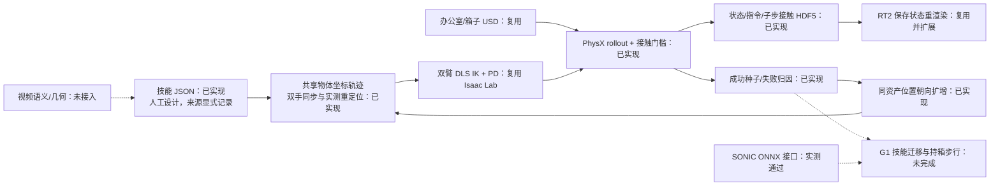

# 双臂搬箱数据生成 baseline

主环境为 Isaac Sim 5.1 / Isaac Lab 2.3.2。物理采集使用 CPU PhysX，RTX 重渲染单独执行。复用本仓库索引的办公室 USD、BEHAVE 箱子扫描资产、Isaac 自带 Panda URDF、Isaac Lab 的 DLS IK / articulation PD / ContactSensor，以及已有 RT2 渲染器。未训练控制器。

当前 A/B 使用两台固定基座 Panda，**不等于 G1 站立平衡验证**。两只手的掌部外壳从相对两侧施压，靠真实摩擦搬箱；手指保持闭合。没有物体 attachment、吸附、运动中写入物体位姿或 kinematic 物体。物体仅在每个 episode 初始化时 reset。用户明确同意先设计办公室任务，故输入为设计的技能规格，没有视频输入，也没有视频重建成功率。



## 运行环境

沿用 `configs/local.runtime.json` 与现有 `sonic` 环境，不升级 torch、Isaac 或驱动。基础数值依赖来自 pyproject；此外需要可导入的 `isaaclab`、Isaac Sim、`pxr`。本机 Panda URDF 和依赖网格由 Isaac 安装自带。首次运行用官方 URDF converter 在实验目录缓存 USD。

复制 `configs/locomanip.runtime.example.json` 为忽略的 `configs/local.locomanip.json`，填写现有资产与 URDF 路径。办公室默认 prim 应与本仓库办公场景一致，箱子必须有 `/Collision` mesh；这不是任意 USD 的通用导入器。复制到新机时须连同 USD 引用/纹理及机器人网格一起搬迁，可用仓库的 `package-assets` 工具打包。

本机可复制命令（从 workspace 根目录运行）：

```bash
export PYTHONPATH="$PWD/g1-realtosim/src${PYTHONPATH:+:$PYTHONPATH}"
export LD_LIBRARY_PATH=/tmp/g1-driver-580.173.02/usr/lib/x86_64-linux-gnu${LD_LIBRARY_PATH:+:$LD_LIBRARY_PATH}
PY=/home/kinetra-4090-01/miniconda3/envs/sonic/bin/python

# 输出目录必须不存在；所有仿真作业串行运行。
"$PY" -m g1_realtosim.locomanip \
  --config g1-realtosim/configs/local.locomanip.json \
  --skill g1-realtosim/configs/locomanip.skill.json \
  --output experiments/my_box_seed

# 只有物理成功的 seed.json 才能进入扩增。
"$PY" -m g1_realtosim.locomanip \
  --config g1-realtosim/configs/local.locomanip.json \
  --skill g1-realtosim/configs/locomanip.skill.json \
  --source-seed experiments/my_box_seed/episode_000/seed.json \
  --seed 20260925 --attempts 3 --output experiments/my_box_batch

"$PY" -m g1_realtosim.locomanip_audit \
  --runs experiments/my_box_seed experiments/my_box_batch \
  --output experiments/my_box_metrics.json

"$PY" -m g1_realtosim.render \
  --episode experiments/my_box_seed/episode_000/render.json \
  --output experiments/my_box_seed/rgb --profile rt2

# 自包含 RGB/state/action 数据，逐帧读回验证；仍保留未通过视觉验收标志。
"$PY" -m g1_realtosim.locomanip_export \
  --episode experiments/my_box_seed/episode_000/episode.h5 \
  --frames experiments/my_box_seed/rgb/frames.h5 \
  --output experiments/my_box_seed/aligned.h5

# 无夹持反例：应被判为失败，不能混入有效示范。
"$PY" -m g1_realtosim.locomanip \
  --config g1-realtosim/configs/local.locomanip.json \
  --skill g1-realtosim/configs/locomanip.skill.json \
  --no-grip --output experiments/my_box_negative
```

匹配驱动库路径是本机临时修复，不适用于其他机器。正常驱动环境不需要该行。命令中的 `PY` 仅是解释器路径变量。数值数据默认无 RGB；视频必须使用对应 episode 的 USD/HDF5，不能用参考关节角替代物理状态。

`aligned.h5` 为自包含 `panda_rgb_action_v1`：`observation/state` 36维（两臂关节位置/速度），`action/position_target` 每帧 `[2,18]`，`action/valid` 显式标记末尾不足两个控制步的情况；物体真值在 `privileged/`。逐RGB和命令读回检查通过才完成导出。它不是 LeRobot 格式，也不是 G1 动作格式。

## 数据与控制契约

`episode.h5` 使用独立的 `bimanual_physx_v1` schema，不冒充原 G1 的 `g1_capture_v1`。控制 50 Hz，物理 200 Hz，渲染默认每两个控制步一帧，即 25 FPS。世界系 Z 向上；米、秒、弧度、牛顿/牛米；四元数 wxyz。

| 字段 | 含义 |
|---|---|
| `observation/*` | 执行命令之前的双臂关节状态、全部刚体位姿、物体状态 |
| `action/joint_position_target` | 两台 Panda 的实际下发目标，18 维，按 `joint_names` 排序；每臂前7项为rad、后2项夹爪为m，不是下一帧状态 |
| `action/ee_pose_target_world` | 规划的左右手世界位姿，区别于实际状态 |
| `next_observation/*` | 执行四个物理子步后的状态，包含最后一个动作 |
| `physics/joint_position_target` | 各子步的目标；同一控制步内保持不变 |
| `physics/hand_object_force_world` | 两手掌部及各两指的 PhysX 过滤接触法向力，左三项然后右三项 |
| `physics/hand_net_force_world` | 相同刚体的总接触法向力 |
| `physics/arm_net_force_world` | 左 link0–7、右 link0–7 的总接触法向力 |
| `physics/actuator_estimated_torque` | Isaac Lab implicit actuator 估计，不是实测关节力矩 |
| `metrics/object_bottom_clearance` | 由实际箱子位姿与源碰撞网格算出的最低点离桌高度 |
| 属性 `actuator_gains` | 本轮恒定 PD 增益与 effort limit；手指两个驱动已从 mimic 转成显式关节 |

物体状态和接触是特权仿真真值，几何/质量/摩擦参数来自资产或工程假设；没有把它们标成视频观测。质量固定 0.3 kg，摩擦 0.8/0.7，均未经实物测量。所有场景动态物体只有双臂和箱子，桌面原有玩偶/提篮在任务层禁用；办公室源资产不修改。渲染中的基座支柱为可视化安装架，Panda 根部固定到世界。

最终控制配置的关节1–4力矩上限87 Nm、关节5–7上限12 Nm，手指20 N；以 `drive_limits_readback.json` 的 PhysX 实际读回为准。早期开发日志中的统一87上限已被显式修正，最终使用修正后重新执行的数据。隐式驱动估计力矩与 PhysX 实际限值是不同数据，不由前者单独推断施加力矩。

技能定义包括手分工、阶段顺序、同步关系、共享参考系及缺失的视频时段。B 是**已验证参数化技能的扩增**：复用种子的控制规格并重新求解、物理执行，不是完整 DexMimicGen 的逐帧轨迹适配实现。箱子沉降和闭合后从实际状态重新定位共享轨迹；两手共同受同一个中心/朝向变换。扩增不调用 VLM 或重跑视频重建。

成功要求：整箱最低点离桌超过 3 cm，双侧接触连续保持至少 0.5 s；最终水平误差小于 3.5 cm、高度误差小于 2 cm、朝向误差小于 0.2 rad；释放后最后一秒速度低于 2.5 cm/s且手物接触消失。任一非预期外部接触超过 5 N 会停止该尝试。独立 audit 复核时间对齐及全部物理子步，失败保留原因。

## 尚未完成的范围

- 没有视频到数值几何的本次运行；视频输入数为 0，成功率为 null。人工视频标注时间为 0，工程设计/审查人工时间未计时，保持 null。
- 仅对这一桌面布局的分阶段路径执行和接触拒绝做了验证，尚无通用碰撞规划器。Panda 内部自碰撞关闭，因此外部接触通过不等于完整自碰撞证明。
- G1/Revo2 操作迁移、站位选择、实际到达状态接续与持箱行走未完成。不能将两台固定 Panda 的种子直接用于 G1，也不能把 SONIC planner 的 ONNX 成功当作带载步行成功。
- RGB 为保存物理状态的重渲染，物理成功与视觉质量独立。未完成原生帧率时间质量审查，`training_eligible=false`。本轮不直接套用 G1 专用 LeRobot action schema。
- 当前单进程批量 reset，支持按随机种子划分多个串行批次；没有宣称已验证 GPU 向量化规模性能。

参考项目接口与许可审查见 [LOCOMANIP_REFERENCES.md](LOCOMANIP_REFERENCES.md)。实际尝试、视频和成本以 workspace 中 `experiments/20260925_locomanip_baseline/REPORT.md` 为准。
